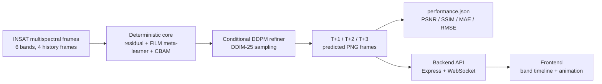
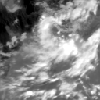
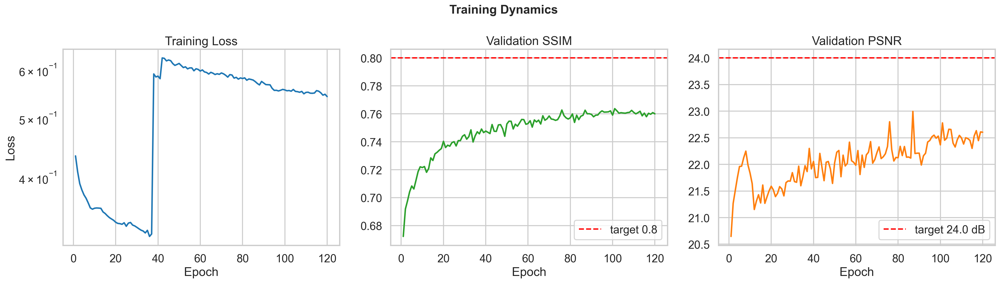
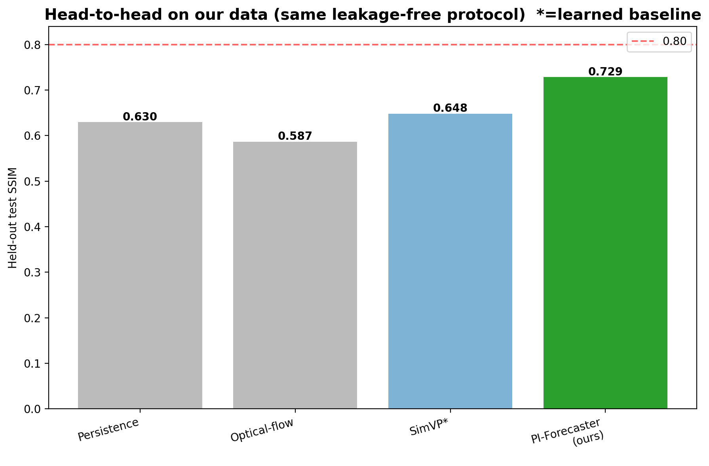
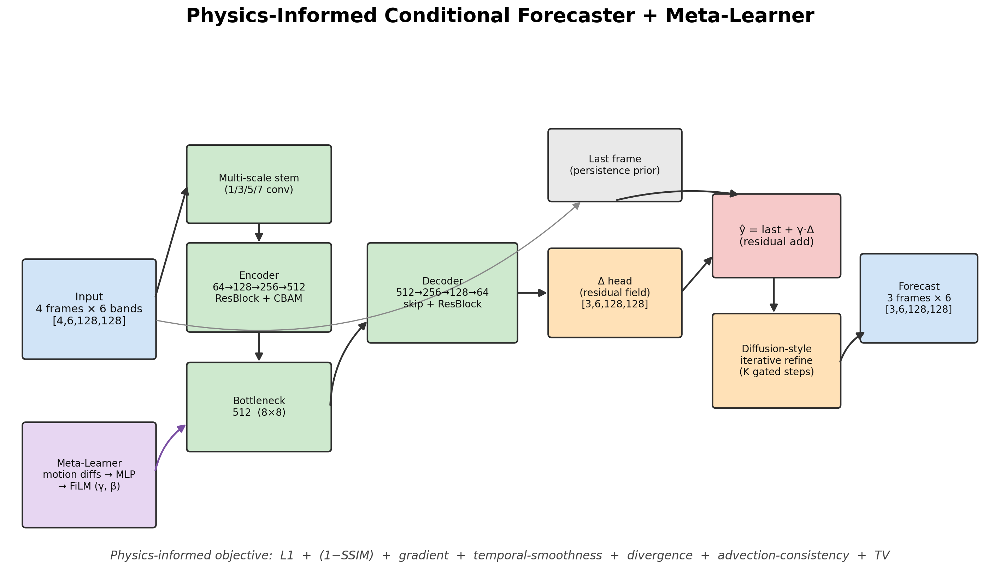
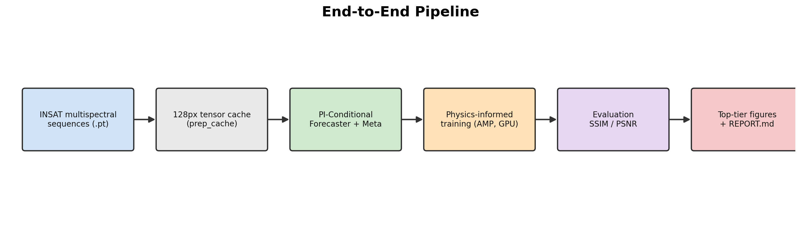

<div align="center">
  
  <h1>K.A.L.A.M.</h1>
  <h3>Knowledge-guided Atmospheric Learning for Adaptive Motion Forecasting</h3>
  <p><strong>Team DOMinators</strong> — National Runner-up (2nd Place), ISRO Bhartiya Antariksh Hackathon 2025</p>
</div>

---

K.A.L.A.M. is a near-term (T+1…T+3) atmospheric nowcasting system for INSAT multi-spectral satellite imagery, paired with a full web application for map-based exploration, animation, and model report views. It combines a Python research/serving ML pipeline, a Node.js/Express API with WebSocket live logs, Cloudflare R2 storage, MongoDB persistence, and a React + Vite + Tailwind UI.

This README is the single source of truth for the project — architecture, measured results, reproduction steps, and known limitations.

## Table of Contents

1. [Monorepo Layout](#monorepo-layout)
2. [Tech Stack](#tech-stack)
3. [Pipeline At A Glance](#pipeline-at-a-glance)
4. [Visual Results](#visual-results)
5. [ML Architecture (Python-Backend)](#ml-architecture-python-backend)
6. [Measured Results](#measured-results)
7. [Reproducibility](#reproducibility)
8. [Python-Backend Structure](#python-backend-structure)
9. [Experimental / Future Work](#experimental--future-work)
10. [Known Limitations](#known-limitations)
11. [Full-Stack Quick Start](#full-stack-quick-start)
12. [API Overview](#api-overview-backend)
13. [Frontend Highlights](#frontend-highlights)
14. [Troubleshooting](#troubleshooting)
15. [Citation](#citation)
16. [Acknowledgements & License](#acknowledgements--license)

---

## Monorepo Layout

- `frontend/` — React/Vite app (UI, animations, map visualization, reports)
- `backend/` — Express API + WebSocket server + R2 uploads + MongoDB
- `Python-Backend/` — ML research, training, and serving pipeline (see below)
- `Inference/` — a small, curated example sequence (input tensor + predicted PNGs + metrics) for a quick look without running the pipeline

## Tech Stack

- **Frontend:** React 19, Vite, Tailwind CSS, react-router, lucide-react
- **Backend:** Node.js, Express, WebSocket (`ws`), Multer, MongoDB (Mongoose)
- **Storage:** Cloudflare R2 via AWS SDK v3
- **ML:** PyTorch 2.6 (CUDA 12.4), a conditional-diffusion U-Net, ONNX export, FastAPI serving

---

## Pipeline At A Glance



---

## Visual Results

Representative future-frame predictions from [`Inference/output/sequence_0010`](Inference/output/sequence_0010) (TIR1 band, T+5/T+6/T+7 steps of the sequence):

<div align="center">
  
  
  
</div>

Training dynamics and SOTA comparison (full figure set in [`Python-Backend/results/`](Python-Backend/results/)):

<div align="center">
  
  
</div>

---

## ML Architecture (Python-Backend)

A physics-informed conditional-diffusion forecaster for INSAT multi-spectral nowcasting: 6 bands (TIR1, TIR2, WV, VIS, MIR, SWIR), 4 observed 128×128 frames → 3 forecast frames (T+1…T+3), evaluated under a strict **leakage-free**, chronological train/val/test protocol.




### Deterministic core — `PIConditionalForecaster` (`src/pidm_model.py`)

- **Residual-from-persistence head**, zero-initialized so that at training step 0 the model output *is* the persistence baseline — the model only has to learn the *correction*, not the whole frame.
- **Meta-learner (FiLM):** encodes the temporal difference between input frames into a "motion" embedding, which produces per-channel scale/shift (γ/β) parameters that modulate the U-Net bottleneck.
- **CBAM** (channel + spatial attention) blocks throughout the encoder/decoder, with GroupNorm.
- **Gated `RefineNet`:** a diffusion-style iterative refinement head applied after the main decode, sharpening high-frequency detail.
- 43.2M parameters.

### Generative refiner — conditional DDPM (`src/pidm_diffusion.py`)

- A **literal conditional diffusion model** (not an approximation): forward noising process `q(r_t | r_0)` on the *residual*, a time-embedded conditional U-Net denoiser, trained for T=1000 steps.
- **DDIM sampling** (25 steps) at inference for speed; **ensemble sampling** (M=12) used to derive calibrated uncertainty estimates.
- 3.7M parameters, adds perceptual/textural realism that the deterministic core (trained to minimize pixel error) smooths away.

### Physics-informed loss (`src/pidm_losses.py`, `CombinedLoss`)

Differentiable SSIM/MS-SSIM, total variation, temporal smoothness, a dense Lucas-Kanade optical-flow estimator, advection-consistency, and a **mass-continuity PDE residual** (`∂ₜI + ∇·(Iu)`), combined as:

| Term | Weight |
|---|---|
| L1 | 1.0 |
| MSE | 0.6 |
| 1 − SSIM (per-frame, lead-weighted) | 1.0 |
| 1 − MS-SSIM (fine-tune stage) | 2.0 |
| Multi-scale gradient | 0.15 |
| Temporal consistency | 0.15 |
| Total variation | 0.02 |
| Advection consistency | 0.10 |
| Continuity-PDE (physics) | 0.03 |
| Lead-time weights (T+1 / T+2 / T+3) | 0.6 / 1.0 / 1.4 |
| SSL flip-consistency | 0.3 |

### Training schedule

Seeded (`--seed 42`), AdamW (weight-decay 1e-5, grad-clip 0.5), bf16 autocast, warmup-cosine LR:

1. **Stage 1:** lr 2e-4, batch 12, ~87 epochs.
2. **Stage 2:** + flip augmentation + EMA(0.999) + self-supervised (SSL) consistency, lr 8e-5, ~40 epochs.
3. **Stage 3:** + corrected continuity-PDE fine-tuning, lr 8e-5, ~12 epochs.
4. **Inference:** 4× flip test-time augmentation (TTA).

---

## Measured Results

Held-out test set (210 chronological windows), identical protocol and estimator for every method, 4× TTA on all learned methods.

| Method | PSNR (dB) ↑ | SSIM ↑ | MAE ↓ | RMSE ↓ | LPIPS ↓ |
|---|---|---|---|---|---|
| Persistence | 20.12 | 0.630 | 0.081 | 0.130 | 0.077 |
| Optical flow (Farnebäck) | 19.58 | 0.587 | 0.085 | 0.135 | 0.112 |
| SimVP (retrained, fair protocol) | 21.00 | 0.648 | 0.072 | 0.126 | 0.073 |
| **K.A.L.A.M. (ours)** | **22.31** | **0.728** | **0.059** | **0.093** | 0.179 |

- **+0.080 SSIM over a fairly-retrained SimVP**; Wilcoxon signed-rank vs. persistence p ≈ 3.3×10⁻³⁶ (n=210).
- LPIPS is highest for K.A.L.A.M. by design — the deterministic mean is smooth; the diffusion refiner restores perceptual realism (see RAPSD below), which is a framing strength, not hidden.

**Per lead-time:**

| Horizon | SSIM ↑ | PSNR (dB) ↑ |
|---|---|---|
| +15 min | 0.804 | 24.00 |
| +30 min | 0.725 | 22.06 |
| +45 min | 0.657 | 20.87 |

**Ablation (matched 45-epoch budget, `results/ablation_full.json`):**

| Variant | SSIM ↑ | ΔSSIM | Reading |
|---|---|---|---|
| Full (residual + meta + refine) | 0.707 | — | baseline |
| − residual-from-persistence | 0.220 | **−0.487** | dominant driver — collapses without it |
| − meta-learner | 0.630 | **−0.077** | falls back to persistence-level |
| − refine module* | 0.694 | −0.013 | minor regulariser |
| − physics loss* | 0.697 | −0.010 | minor regulariser |

\*trained at reduced (28-epoch) budget — deltas conflate removal with less training.

**Generative fidelity & uncertainty (diffusion subset, M=12 ensemble):**

| Quantity | Value |
|---|---|
| RAPSD high-frequency fidelity (diffusion vs. deterministic) | 84.3% vs. 46.6% |
| CRPS reduction (ensemble vs. deterministic) | −19.9% |
| Reliability correlation | 0.945 (rank-reliable) |
| Spread–skill correlation | 0.612 |
| Calibration verdict | **rank-reliable but under-dispersed** — not "calibrated" |

**Efficiency (measured, RTX 3050 6GB Laptop, batch=1):**

| Quantity | Value |
|---|---|
| Parameters | 47.0M (43.2M deterministic + 3.7M diffusion) |
| Deployable weights | 173MB fp32 / 86MB fp16 |
| Latency (deterministic) | 0.68s |
| Latency (+4× TTA) | 2.73s |
| Latency (+diffusion, DDIM-25) | 4.54s |
| Peak GPU memory | 1.87GB (det.), 0.80GB (diffusion) |

All figures backing these tables live in [`Python-Backend/results/`](Python-Backend/results/) (40+ PNGs + JSON metrics — ablation, calibration, SOTA comparison, XAI attention/saliency, RGB composites, per-band/per-lead-time breakdowns).

---

## Reproducibility

- **Data:** 1489 overlapping sliding windows (4→3 frames, 6 bands, 128×128) from a single ~12h INSAT day. Per-clip min-max normalization to [0,1]. Filename timestamps are a defaulted placeholder (1970-05-30, uniform 0.5-min spacing) — treated as nominal, not true acquisition cadence (a stated limitation).
- **Split:** chronological, `src/data_split.py` — train 1042 / val 223 / test 210, with a 7-window buffer between partitions so no frame is shared across splits (leakage-free).
- **Non-determinism:** cuDNN convolution kernels aren't bit-deterministic; metrics reproduce to ~±0.002 SSIM across runs.

```bash
cd Python-Backend
pip install -r requirements.txt                              # PyTorch 2.6 + CUDA 12.4

# Research track — train & evaluate
python src/prep_cache.py                                      # build 128px tensor cache
python src/train_pidm.py --epochs 260 --batch 12 --augment --ema 0.999 \
       --w_ssl 0.3 --w_pde 0.03 --w_msssim 2.0 --lead_weights 0.6,1.0,1.4
python src/train_diffusion.py --epochs 40                     # conditional DDPM
python src/evaluate_and_plot.py                               # metrics + figures
python src/baseline_simvp.py --epochs 70                       # learned baseline
python src/make_sota_comparison.py                             # head-to-head verdict
python src/uncertainty_calibration.py                          # CRPS / spread-skill
python src/tgrs_analysis.py                                    # RAPSD sharpness
python src/run_ablations.py --epochs 28 && python src/ablation_eval.py
python src/efficiency_benchmark.py                              # latency / memory / params

# Deployment track — serve predictions
python serving/npy2png.py && python serving/stack.py           # build serving/test_sorted_bands (edit BASE_DIR first)
python serving/train4.py                                       # trains models/best_model.pth
python serving/conv_2_onnx.py                                   # optional: export ONNX
uvicorn serving.main:app --host 127.0.0.1 --port 8000           # POST /run_inference {base_dir, sequence_id}
```

Model checkpoints (`*.pth`/`*.onnx`, ~90MB–1.6GB) are gitignored — train via the commands above, or attach as a GitHub Release / Git-LFS asset.

---

## Python-Backend Structure

```
Python-Backend/
├── requirements.txt
├── .gitignore
├── src/            research track — model, losses, diffusion, training, baselines, ablations, XAI
├── serving/        deployment track — FastAPI inference API + ONNX export (see below)
├── experimental/   exploratory work, NOT validated — see "Experimental / Future Work"
└── results/        40+ figures + metrics JSON backing every number in this README
```

**`serving/`** (FastAPI deployment layer):

- `main.py` — FastAPI app, `POST /run_inference`
- `inference.py` — loads a checkpoint, writes predicted PNGs + metrics
- `train4.py` — "kalam_m1" generation: `EnhancedUNet`, matches the shipped `best_model.pth`
- `train5.py` — "kalam_m2" generation: CBAM/multi-scale UNet + self-supervised retrainer (**not** the model `inference.py`/`main.py` load by default)
- `conv_2_onnx.py` — exports `train4`'s `EnhancedUNet` checkpoint to ONNX
- `npy2png.py`, `stack.py`, `pt2np.py` — raw `.npy` → sorted PNG bands → tensor cache prep
- `view.py` — visualize a cached `.pt` sequence
- `test1.py`, `test2.py` — manual single/batch inference smoke tests

The `serving/` track is younger and less validated than `src/` — it's the same underlying scripts, just cleaned of hardcoded personal paths for portability.

---

## Experimental / Future Work

`Python-Backend/experimental/` is kept for transparency — it's exploratory work **not wired into `src/` or `serving/`**, and not validated the way the rest of the repo has been. Nothing here backs the measured results above.

- **`train6.py`** — a larger `UltraAdvancedUNet` with a **6-layer Transformer bottleneck** (`TemporalTransformer`), dense residual blocks, sinusoidal time-conditioning, and an interactive Tkinter training GUI, trained with a combined focal-L1 / Charbonnier / gradient / temporal ("PhyDiff-PINN") loss. This is the most architecturally ambitious idea in the repo (long-range spatio-temporal attention beyond the CNN receptive field) — but it has **never been benchmarked** against the `src/` evaluation protocol, so its real accuracy is unknown. Promoting it out of `experimental/` would require porting it to the leakage-free split and measuring it head-to-head against the table above.
- **`stabdiff.py`** — adapts a pretrained Stable Diffusion v1.5 U-Net (via `diffusers`) to 6-band satellite frames with a custom conditioning adapter. Implements a full DDPM loop but was never run to a validated result.
- **`fine_tune.py`** — a second Stable-Diffusion fine-tuning attempt. **Known bug:** it never actually noises the latents before denoising (`noisy_latents = noise` instead of `noise_scheduler.add_noise(...)`), so as written the network only learns to predict noise from noise. Left unpatched intentionally — treat as a starting point, not a working trainer.
- **`s.py`** — a one-off HDF5 explorer for inspecting a raw INSAT L1C `.h5` file's dataset layout.

---

## Known Limitations

- **Single-day dataset** — all splits come from one ~12h INSAT day; multi-season generalization is untested (the top priority for follow-up work).
- **Physics term is a regularizer, not a proven advantage** — the continuity-PDE residual is non-discriminative on this low-motion data (persistence trivially scores lowest on it); it helps training stability, not a demonstrated physical constraint win.
- Most named components are individually marginal (≤0.01 SSIM) at matched budget **except** the residual-from-persistence prior (dominant) and the FiLM meta-learner (real secondary contributor, +0.077).
- Uncertainty is rank-reliable but **under-dispersed** — do not read it as calibrated without a spread-inflation correction (~1.5×).
- `serving/` is less validated than `src/`, and `experimental/` is explicitly unfinished (see above).
- A few Windows-specific absolute paths remain hardcoded in the Node backend for local dev — see [Local Paths To Update](#local-paths-to-update-very-important) below.

---

## Full-Stack Quick Start

**Prerequisites:** Node.js 18+, Python 3.10+, MongoDB (local or Atlas), Cloudflare R2 bucket + credentials.

**Backend**

```bash
cd backend
npm install
# create .env — see Environment Variables below
npm run dev        # Express on :3000, WebSocket on :3001
```

**Frontend**

```bash
cd frontend
npm install
npm run dev        # Vite dev server on :5173
```

**Python**

```bash
cd Python-Backend
pip install -r requirements.txt
```

Open the app at `http://localhost:5173`.

### Environment Variables (`backend/.env`)

- **Server:** `PORT=3000`, `NODE_ENV=development`
- **Database:** `MONGO_URL=mongodb://localhost:27017/project-kalam` (or Atlas URI)
- **Cloudflare R2:** `R2_ENDPOINT`, `R2_ACCESS_KEY_ID`, `R2_SECRET_ACCESS_KEY`, `R2_BUCKET_NAME`, `R2_PUBLIC_URL`

On startup, the backend verifies R2 configuration and logs a health summary.

### Local Paths To Update (very important)

A few Windows paths are hard-coded for local dev during the hackathon — update these to match your environment and the `Python-Backend/serving/` layout:

- `backend/controllers/modelTest.controller.js:20` — `pythonScriptPath` currently points outside this repo (`d:\Hackathon\ISRO\pre_final\test1.py`). Point it at your local `Python-Backend/serving/test1.py` (or `test2.py`) instead.
- `backend/app.js:28` and `backend/controllers/modelTest.controller.js:255,445` — `testOutputPath` currently points outside this repo. This should point at wherever you run `serving/inference.py`'s output — that folder is generated at runtime (gitignored), not shipped in the repo.

### Run Flow

- Start backend (`:3000`) and WebSocket server (`:3001`), then the frontend (`:5173`).
- **"Chase The Cloud"** — animate frames and request predictions for T+1…T+3.
- **"Test Model"** — stream Python logs via WebSocket.
- **"Visualize On Map"** — explore overlays (if configured).

---

## API Overview (backend)

Base URL: `http://localhost:3000`

**Core**

- `GET /` — Service info + advertised endpoints
- `GET /api/prediction-images/<relative-path>` — Serves predicted images from `testOutputPath`

**R2 Uploads (`/api/v1`)**

- `POST /upload` — Upload a single file (`field: file`); validates type/size, stores to R2, persists metadata to MongoDB
- `POST /test-upload` — Multer sanity check
- `GET /health` — R2 configuration/health snapshot

**Model Test & Predictions (`/api/v1`)**

- `POST /folder-path` — Triggers the Python validation job; logs stream over WebSocket `ws://localhost:3001`
- `POST /predict-frames` — Body: `{ timeWindow: number[4], selectedDirectory: string, bands: string[], windowSize: number }` → predicted frames metadata + performance aggregates
- `GET /available-sequences` — Lists available `sequence_****` folders under `testOutputPath`

---

## Frontend Highlights

- Multi-band timeline with keyboard navigation and single-cycle animation
- Predicted vs. ground-truth frame browsing for T+1…T+3 with metrics display
- Directory selection via the File System Access API
- Toaster notifications, dark/light theme toggle

**Key Entrypoints**

- `frontend/src/App.jsx` — Routes: `/` (landing), `/test`, `/overlay-clouds`, `/satellite-animation`
- `frontend/src/pages/SatelliteAnimationPage.jsx` — Main nowcasting UI
- `frontend/src/components/ModelTestAndTerminalPreview.jsx` — WebSocket log streaming UI
- `frontend/src/libs/axios.js` — Base API URL (`http://localhost:3000/api/v1`)

**Backend Entrypoints**

- `backend/app.js` — Express setup, static files, WebSocket server, routes
- `backend/routes/r2upload.routes.js`, `backend/controllers/r2upload.controller.js` — Upload/health endpoints + R2/MongoDB persistence
- `backend/routes/modelTest.routes.js`, `backend/controllers/modelTest.controller.js` — Python spawn, prediction assembly, performance parsing
- `backend/config/r2.config.js` — R2 client + connectivity test
- `backend/utils/db.js` — Mongo connection helper
- `backend/models/File.model.js` — File schema

---

## Troubleshooting

- **Images not loading:** update `testOutputPath` in `backend/app.js` and the controller references.
- **WebSocket not connecting:** ensure `ws://localhost:3001` is reachable and not firewalled.
- **Uploads failing:** verify `.env` R2 variables and bucket permissions; check `GET /api/v1/health`.
- **Mongo errors:** confirm `MONGO_URL` and that MongoDB is running.
- **Python errors:** fix `pythonScriptPath`, activate your Python env, and run the target script manually to verify.

---

## Citation

If you use or extend this work, please cite the repository and team:

```bibtex
@misc{kalam2025,
  title        = {K.A.L.A.M.: Knowledge-guided Atmospheric Learning for Adaptive Motion Forecasting},
  author       = {Team DOMinators},
  year         = {2025},
  howpublished = {\url{https://github.com/info-gallary/K.A.L.A.M.}},
  note         = {National Runner-up, ISRO Bhartiya Antariksh Hackathon 2025}
}
```

---

## Acknowledgements & License

- ISRO Bhartiya Antariksh Hackathon 2025 — National Runner-up (2nd Place)
- Gratitude to mentors, organizers, and the open-source community
- **License:** MIT — see [`LICENSE`](LICENSE)
